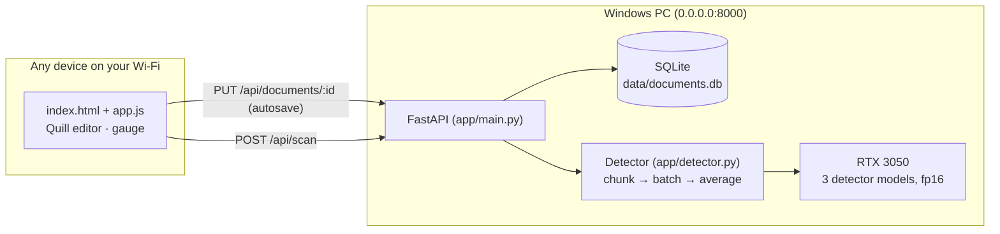

# ScribeScan — Local AI Text Detector + Auto-Saving Editor

A self-hosted, Google-Docs-style writing app with a built-in AI-text detector that runs **entirely on your own GPU**.
Write or paste text, and it auto-saves to a local SQLite database as you type. Press **Scan for AI** to score it with
an ensemble of three detector models, see which sections look AI-written highlighted in the text, and get notes on why
and how to revise them. Every device on your Wi-Fi can open it in a browser.

**Stack:** FastAPI · SQLite · PyTorch (CUDA) · Hugging Face Transformers · Quill.js · vanilla JS/CSS

---

## Features

**Editor**
- Rich-text editor (Quill) with a dark theme that works on desktop and mobile
- Multiple documents in a sidebar: create, switch, rename, delete
- **Auto-save:** saves 1.2 s after you stop typing and at least every 5 s while you type, and flushes when you switch documents or close the tab
- **Multi-device sync:** documents are versioned. Other devices pick up changes within about 15 s. If two devices edit the same document at once, you get a conflict prompt instead of losing edits silently
- Shortcuts: `Ctrl+S` saves, `Ctrl+Enter` runs a scan

**Detection pipeline**
1. **Minimum length:** scans need at least **300 words**. The UI checks this and the server checks it again.
2. **Sliding window:** the text is split into **500-word windows with 150 words of overlap**, cut from the original text so paragraph breaks survive. The last window ends exactly at the end of the text, so the tail is always scored as a full window.
3. **GPU inference:** each window is scored in fp16 on CUDA by three detectors: [tropa-mini](https://huggingface.co/wasitaigeneratedcom/tropa-mini-ai-text-detector) (primary), [desklib](https://huggingface.co/desklib/ai-text-detector-v1.01) and [vanguard](https://huggingface.co/ShantanuT01/vanguard-ai-text-detector). Together they use about 3 GB of VRAM, and a scan takes one to two seconds.
4. **Ensemble and aggregation:** a window counts as AI only if the primary model flags it **and** at least one of the other two confirms (`min(primary, max(others))`). The document score is the **mean** of the window scores.
5. **Section scores:** smaller windows (150 words, overlapping by 100) spread the score onto individual words, and from there onto paragraph-sized sections. If an unbroken passage of 150+ words scores 80% or more, this fine-grained score can raise the document score, so a text that is half AI isn't cleared.
6. **20% threshold:** a score under 20% is shown as **"Human-Written"**. The server strips every AI number (document, per-model and per-section) before sending the response, so the browser never receives them.
7. A scan is labelled **Outdated** once the text changes after it, and each document remembers its last scan.

**Section insights**
- **Highlights in the text:** flagged sections are tinted by tier (possibly AI / likely AI / AI-like) using the CSS Custom Highlight API, so nothing is added to the saved document. Click a highlight to open its notes.
- **Why and what to change:** each flagged section lists the style patterns found in it (stock phrases, even sentence rhythm, connector-led sentences, lists of three, "not X, but Y" framing, tidy summing-up, no contractions, adverb load, vague wording, dash overuse), each with a concrete revision tip.
- **Text analytics:** sentence-length variation, vocabulary variety (MATTR), Flesch reading ease, contraction rate, connector openers, stock-phrase count, reading time.

The percentages come from the neural models. The style notes are transparent heuristics that describe what a reader
might notice; they are not the models' internal reasoning, and human writing can trigger them too.

**Why these models?** The first version used `Hello-SimpleAI/chatgpt-detector-roberta` with 200-word windows. It labelled
AI-written stories from current models as "Human-Written" and also flagged 43% of genuine human stories. I compared nine
open detectors, several window sizes and a dozen ensembling rules; the results are in
[benchmarks/README.md](benchmarks/README.md). The current setup detects 18/18 AI texts across ten styles and wrongly
flags 8 of 120 human texts (all of them fiction; 0 of 60 reviews and news articles).

## Architecture



```
ai-detector/
├── app/
│   ├── main.py        # FastAPI app factory, routes, optional LAN access token
│   ├── detector.py    # windowing, multi-model GPU inference, ensemble, section scores, threshold logic
│   ├── analysis.py    # section splitting, text analytics, style signals + revision tips (no model)
│   ├── database.py    # SQLite schema + queries, optimistic-concurrency saves
│   ├── schemas.py     # request models (pydantic)
│   ├── config.py      # every setting, overridable via AIDET_* env vars
│   └── __main__.py    # `python -m app`
├── static/
│   ├── index.html
│   ├── css/styles.css
│   ├── js/app.js      # tabs, autosave, sync, scan UI
│   ├── js/insights.js # in-text highlights, section notes, analytics card
│   ├── js/api.js      # fetch wrapper
│   └── vendor/quill/  # Quill 2.0.3, vendored so the app works without internet
├── benchmarks/        # detector benchmark: evaluate.py, AI samples, results write-up
├── tests/             # pytest suite (runs without a GPU)
├── scripts/           # setup / run / firewall helpers for Windows
├── launch.bat         # double-click launcher (first run installs everything)
├── requirements.txt
└── requirements-dev.txt
```

---

## Setup (Windows, NVIDIA GPU)

Requirements: Python 3.10+, a recent NVIDIA driver, and Git.

```powershell
git clone <your-repo-url> ai-detector
cd ai-detector
powershell -ExecutionPolicy Bypass -File scripts\setup.ps1
```

`setup.ps1` creates `.venv`, installs the **CUDA build of PyTorch** (`cu124` by default; use `-Cuda cu126` to pick another build), installs `requirements.txt`, and checks that CUDA is visible.

<details>
<summary>Manual setup instead of the script</summary>

```powershell
python -m venv .venv
.\.venv\Scripts\Activate.ps1
pip install torch --index-url https://download.pytorch.org/whl/cu124
pip install -r requirements.txt
python -c "import torch; print(torch.cuda.is_available())"   # should print True
```
</details>

## Quick start: double-click `launch.bat`

Double-click **`launch.bat`** in the project folder:

- **On the first run**, it runs `setup.ps1` for you.
- **On later runs**, it starts the server and opens `http://localhost:8000` in your browser once the server answers.

Keep the window open while you use the app. Close it or press `Ctrl+C` to stop the server.
For a desktop shortcut, right-click `launch.bat`, choose **Show more options → Send to → Desktop (create shortcut)**, and rename the shortcut to "ScribeScan".
`launch.bat nobrowser` starts the server without opening a browser.

## Run it on your local network

```powershell
.\.venv\Scripts\Activate.ps1
uvicorn app.main:app --host 0.0.0.0 --port 8000
```

You can also run `launch.bat`, `powershell -ExecutionPolicy Bypass -File scripts\run.ps1`, or `python -m app`.

`--host 0.0.0.0` makes the server listen on every network interface, so other devices can reach it. On startup it prints
the URLs to use:

```
Local:   http://localhost:8000
Network: http://192.168.1.23:8000   <- open this on other devices on your Wi-Fi
```

The first start downloads the three detector models (about 5 GB) into `~/.cache/huggingface`. The editor works while it loads, and the
sidebar badge turns green when the detector is ready.

### If other devices can't connect

1. Set your Wi-Fi to **Private**: *Settings → Network & internet → Wi-Fi → (your network) → Private network*.
2. Allow the port through Windows Firewall. Run this **as Administrator**, once:
   ```powershell
   powershell -ExecutionPolicy Bypass -File scripts\allow-firewall.ps1
   ```
3. Find your PC's IP with `ipconfig` (the *IPv4 Address* under your Wi-Fi adapter) and open `http://<that-ip>:8000`.

### Optional: require an access token

By default, anyone on your Wi-Fi can open the app. To lock it:

```powershell
$env:AIDET_ACCESS_TOKEN = "pick-a-long-random-string"
uvicorn app.main:app --host 0.0.0.0 --port 8000
```

Open `http://<ip>:8000/?token=pick-a-long-random-string` once on each device. A cookie keeps that device signed in.

---

## Configuration

All settings are environment variables:

| Variable | Default | Meaning |
|---|---|---|
| `AIDET_MODELS` | tropa-mini, desklib, vanguard | Comma-separated Hugging Face repos; the first is the primary. Any sequence-classification model works, plus desklib-style mean-pool models |
| `AIDET_ENSEMBLE` | `confirm` | `confirm` = primary plus at least one other; `min` = every model must agree (fewest false flags, misses more AI); `mean` = average |
| `AIDET_SECTION_WINDOW_WORDS` / `AIDET_SECTION_WINDOW_OVERLAP` | `150` / `100` | Fine windows used for section scores |
| `AIDET_PARTIAL_RUN_WORDS` | `150` | Length of a strongly AI-like passage that can raise the document score; `0` turns this off |
| `AIDET_DEVICE` | `cuda` | Falls back to CPU automatically if CUDA isn't available |
| `AIDET_AI_LABEL` | *(auto)* | For softmax models: name of the "AI" label, if auto-detection guesses wrong |
| `AIDET_MIN_WORDS` | `300` | Minimum words per scan |
| `AIDET_CHUNK_WORDS` / `AIDET_CHUNK_OVERLAP` | `500` / `150` | Sliding-window size and overlap |
| `AIDET_HUMAN_THRESHOLD` | `0.20` | Scores below this show as "Human-Written" with no number |
| `AIDET_BATCH_SIZE` | `8` | Windows per GPU batch |
| `AIDET_MAX_WORDS` | `50000` | Largest text one scan will accept |
| `AIDET_DB_PATH` | `data/documents.db` | SQLite file location |
| `AIDET_ACCESS_TOKEN` | *(off)* | Shared secret for LAN access |
| `AIDET_PORT` | `8000` | Port used by `python -m app` and in the printed URLs |

## API

Interactive docs are at `http://localhost:8000/docs`.

| Method | Path | Purpose |
|---|---|---|
| `GET` | `/api/health` | Model status (loading / ready / error, device) and guardrail settings |
| `GET` | `/api/documents` | List documents (summaries) |
| `POST` | `/api/documents` | Create a document |
| `GET` | `/api/documents/{id}` | Full document plus its latest scan (with an `is_stale` flag) |
| `PUT` | `/api/documents/{id}` | Save. Send the `version` you edited; returns **409** with the server copy if it's stale |
| `DELETE` | `/api/documents/{id}` | Delete a document and its scans |
| `POST` | `/api/scan` | `{text, document_id?}`. Result includes `sections` (character offsets, probability, signals, tips) and `analytics`. Returns **422** `too_short` under 300 words, **503** while the model loads |

## Tests

```powershell
pip install -r requirements-dev.txt
pytest -q
```

The suite replaces the model with a deterministic fake, so it runs anywhere. It covers window coverage and overlap,
averaging, the 20% redaction (including the case where a single window is over 20% but the mean is under), version
conflicts, scan persistence and staleness, and the access-token gate.

## Data & privacy

- Text never leaves your machine. Inference runs locally and documents live in `data/documents.db`, which git ignores.
- SQLite runs in WAL mode, and every query is parameterised.
- Back up your documents by copying the `data/` folder while the server is stopped.

## Limitations

AI-text detectors are **probabilistic**. In the benchmark, 8 of 60 human short stories were still flagged (0 of 60
reviews and news articles), mostly polished, conventional fiction. Section scores are less reliable than the document
score because they rest on shorter windows. Text run through "humanizer" or paraphrasing tools, heavily
edited AI drafts, the very newest models, and non-native English writing can all be misjudged. Treat a score as one
signal, never as proof of authorship.

## Credits

- Detector models: [wasitaigeneratedcom/tropa-mini-ai-text-detector](https://huggingface.co/wasitaigeneratedcom/tropa-mini-ai-text-detector) (Apache-2.0) and [desklib/ai-text-detector-v1.01](https://huggingface.co/desklib/ai-text-detector-v1.01) (MIT), both built on DeBERTa-v3-large, and [ShantanuT01/vanguard-ai-text-detector](https://huggingface.co/ShantanuT01/vanguard-ai-text-detector) (MIT), built on ModernBERT-large
- Human benchmark texts: WritingPrompts (r/WritingPrompts), IMDB reviews, and BBC articles from XSum
- Editor: [Quill](https://quilljs.com) (BSD-3-Clause, license in `static/vendor/quill/LICENSE`)
