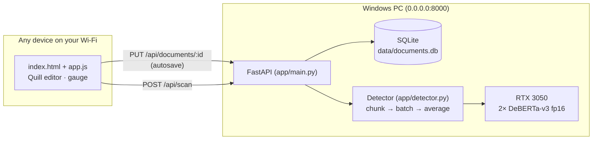

# ScribeScan — Local AI Text Detector + Auto-Saving Editor

A self-hosted, Google-Docs-style writing app with a built-in AI-text detector that runs **entirely on your own GPU**.
Write or paste text, and it auto-saves to a local SQLite database as you type. Press **Scan for AI** to score it with
two DeBERTa-v3 detectors that must agree. Every device on your Wi-Fi can open it in a browser.

**Stack:** FastAPI · SQLite · PyTorch (CUDA) · Hugging Face Transformers · Quill.js · vanilla JS/CSS

---

## Features

**Editor**
- Rich-text editor (Quill) with a dark theme that works on desktop and mobile
- Multiple documents in a sidebar: create, switch, rename, delete
- **Auto-save:** saves 1.2 s after you stop typing and at least every 5 s while you type, and flushes when you switch documents or close the tab
- **Multi-device sync:** documents are versioned. Other devices pick up changes within about 15 s. If two devices edit the same document at once, you get a conflict prompt instead of losing edits silently
- Shortcuts: `Ctrl+S` saves, `Ctrl+Enter` runs a scan

**Detection pipeline**
1. **Minimum length:** scans need at least **300 words**. The UI checks this and the server checks it again.
2. **Sliding window:** the text is split into **500-word windows with 150 words of overlap**, cut from the original text so paragraph breaks survive. The last window ends exactly at the end of the text, so the tail is always scored as a full window.
3. **GPU inference:** each window is scored in fp16 on CUDA by two detectors: [desklib/ai-text-detector-v1.01](https://huggingface.co/desklib/ai-text-detector-v1.01), which led the RAID benchmark, and its 2026 fine-tune [tropa-mini](https://huggingface.co/wasitaigeneratedcom/tropa-mini-ai-text-detector). Together they use about 2 GB of VRAM, and a scan takes about 0.4 s.
4. **Ensemble and aggregation:** a window's score is the **lower** of the two models' scores, so both must agree it's AI. The document score is the **mean** of the window scores.
5. **20% threshold:** a score under 20% is shown as **"Human-Written"**. The server strips the exact numbers before sending the response, so the browser never receives them.
6. A section breakdown strip shows which parts of the text scored highest, along with each model's own score. A scan is labelled **Outdated** once the text changes after it, and each document remembers its last scan.

**Why these models?** The first version used `Hello-SimpleAI/chatgpt-detector-roberta` with 200-word windows. It labelled
AI-written stories from current models as "Human-Written" and also flagged 43% of genuine human stories. I compared nine
open detectors, several window sizes and two ensembling rules; the results are in
[benchmarks/README.md](benchmarks/README.md). The current setup caught 10/10 AI texts and wrongly flagged 4 of 60 human stories.

## Architecture



```
ai-detector/
├── app/
│   ├── main.py        # FastAPI app factory, routes, optional LAN access token
│   ├── detector.py    # windowing, multi-model GPU inference, ensemble, threshold logic
│   ├── database.py    # SQLite schema + queries, optimistic-concurrency saves
│   ├── schemas.py     # request models (pydantic)
│   ├── config.py      # every setting, overridable via AIDET_* env vars
│   └── __main__.py    # `python -m app`
├── static/
│   ├── index.html
│   ├── css/styles.css
│   ├── js/app.js      # tabs, autosave, sync, scan UI
│   ├── js/api.js      # fetch wrapper
│   └── vendor/quill/  # Quill 2.0.3, vendored so the app works without internet
├── benchmarks/        # detector benchmark: evaluate.py, AI samples, results write-up
├── tests/             # pytest suite (runs without a GPU)
├── scripts/           # setup / run / firewall helpers for Windows
├── launch.bat         # double-click launcher (first run installs everything)
├── requirements.txt
└── requirements-dev.txt
```

---

## Setup (Windows, NVIDIA GPU)

Requirements: Python 3.10+, a recent NVIDIA driver, and Git.

```powershell
git clone <your-repo-url> ai-detector
cd ai-detector
powershell -ExecutionPolicy Bypass -File scripts\setup.ps1
```

`setup.ps1` creates `.venv`, installs the **CUDA build of PyTorch** (`cu124` by default; use `-Cuda cu126` to pick another build), installs `requirements.txt`, and checks that CUDA is visible.

<details>
<summary>Manual setup instead of the script</summary>

```powershell
python -m venv .venv
.\.venv\Scripts\Activate.ps1
pip install torch --index-url https://download.pytorch.org/whl/cu124
pip install -r requirements.txt
python -c "import torch; print(torch.cuda.is_available())"   # should print True
```
</details>

## Quick start: double-click `launch.bat`

Double-click **`launch.bat`** in the project folder:

- **On the first run**, it runs `setup.ps1` for you.
- **On later runs**, it starts the server and opens `http://localhost:8000` in your browser once the server answers.

Keep the window open while you use the app. Close it or press `Ctrl+C` to stop the server.
For a desktop shortcut, right-click `launch.bat`, choose **Show more options → Send to → Desktop (create shortcut)**, and rename the shortcut to "ScribeScan".
`launch.bat nobrowser` starts the server without opening a browser.

## Run it on your local network

```powershell
.\.venv\Scripts\Activate.ps1
uvicorn app.main:app --host 0.0.0.0 --port 8000
```

You can also run `launch.bat`, `powershell -ExecutionPolicy Bypass -File scripts\run.ps1`, or `python -m app`.

`--host 0.0.0.0` makes the server listen on every network interface, so other devices can reach it. On startup it prints
the URLs to use:

```
Local:   http://localhost:8000
Network: http://192.168.1.23:8000   <- open this on other devices on your Wi-Fi
```

The first start downloads the two detector models (about 3.5 GB) into `~/.cache/huggingface`. The editor works while it loads, and the
sidebar badge turns green when the detector is ready.

### If other devices can't connect

1. Set your Wi-Fi to **Private**: *Settings → Network & internet → Wi-Fi → (your network) → Private network*.
2. Allow the port through Windows Firewall. Run this **as Administrator**, once:
   ```powershell
   powershell -ExecutionPolicy Bypass -File scripts\allow-firewall.ps1
   ```
3. Find your PC's IP with `ipconfig` (the *IPv4 Address* under your Wi-Fi adapter) and open `http://<that-ip>:8000`.

### Optional: require an access token

By default, anyone on your Wi-Fi can open the app. To lock it:

```powershell
$env:AIDET_ACCESS_TOKEN = "pick-a-long-random-string"
uvicorn app.main:app --host 0.0.0.0 --port 8000
```

Open `http://<ip>:8000/?token=pick-a-long-random-string` once on each device. A cookie keeps that device signed in.

---

## Configuration

All settings are environment variables:

| Variable | Default | Meaning |
|---|---|---|
| `AIDET_MODELS` | `desklib/ai-text-detector-v1.01,wasitaigeneratedcom/tropa-mini-ai-text-detector` | Comma-separated detectors. Any HF sequence-classification model works, plus desklib-style mean-pool models |
| `AIDET_ENSEMBLE` | `min` | `min` = every model must agree (fewest false flags); `mean` = average |
| `AIDET_DEVICE` | `cuda` | Falls back to CPU automatically if CUDA isn't available |
| `AIDET_AI_LABEL` | *(auto)* | For softmax models: name of the "AI" label, if auto-detection guesses wrong |
| `AIDET_MIN_WORDS` | `300` | Minimum words per scan |
| `AIDET_CHUNK_WORDS` / `AIDET_CHUNK_OVERLAP` | `500` / `150` | Sliding-window size and overlap |
| `AIDET_HUMAN_THRESHOLD` | `0.20` | Scores below this show as "Human-Written" with no number |
| `AIDET_BATCH_SIZE` | `8` | Windows per GPU batch |
| `AIDET_MAX_WORDS` | `50000` | Largest text one scan will accept |
| `AIDET_DB_PATH` | `data/documents.db` | SQLite file location |
| `AIDET_ACCESS_TOKEN` | *(off)* | Shared secret for LAN access |
| `AIDET_PORT` | `8000` | Port used by `python -m app` and in the printed URLs |

## API

Interactive docs are at `http://localhost:8000/docs`.

| Method | Path | Purpose |
|---|---|---|
| `GET` | `/api/health` | Model status (loading / ready / error, device) and guardrail settings |
| `GET` | `/api/documents` | List documents (summaries) |
| `POST` | `/api/documents` | Create a document |
| `GET` | `/api/documents/{id}` | Full document plus its latest scan (with an `is_stale` flag) |
| `PUT` | `/api/documents/{id}` | Save. Send the `version` you edited; returns **409** with the server copy if it's stale |
| `DELETE` | `/api/documents/{id}` | Delete a document and its scans |
| `POST` | `/api/scan` | `{text, document_id?}`. Returns **422** `too_short` under 300 words, **503** while the model loads |

## Tests

```powershell
pip install -r requirements-dev.txt
pytest -q
```

The suite replaces the model with a deterministic fake, so it runs anywhere. It covers window coverage and overlap,
averaging, the 20% redaction (including the case where a single window is over 20% but the mean is under), version
conflicts, scan persistence and staleness, and the access-token gate.

## Data & privacy

- Text never leaves your machine. Inference runs locally and documents live in `data/documents.db`, which git ignores.
- SQLite runs in WAL mode, and every query is parameterised.
- Back up your documents by copying the `data/` folder while the server is stopped.

## Limitations

AI-text detectors are **probabilistic**. In the benchmark, about 1 in 15 human stories was still shown as "Possibly
AI-Assisted" or higher, mostly polished, conventional prose. Text run through "humanizer" or paraphrasing tools, heavily
edited AI drafts, the very newest models, and non-native English writing can all be misjudged. Treat a score as one
signal, never as proof of authorship.

## Credits

- Detector models: [desklib/ai-text-detector-v1.01](https://huggingface.co/desklib/ai-text-detector-v1.01) (MIT) and [wasitaigeneratedcom/tropa-mini-ai-text-detector](https://huggingface.co/wasitaigeneratedcom/tropa-mini-ai-text-detector) (Apache-2.0), both built on DeBERTa-v3-large
- Human benchmark stories: the WritingPrompts dataset (r/WritingPrompts)
- Editor: [Quill](https://quilljs.com) (BSD-3-Clause, license in `static/vendor/quill/LICENSE`)
